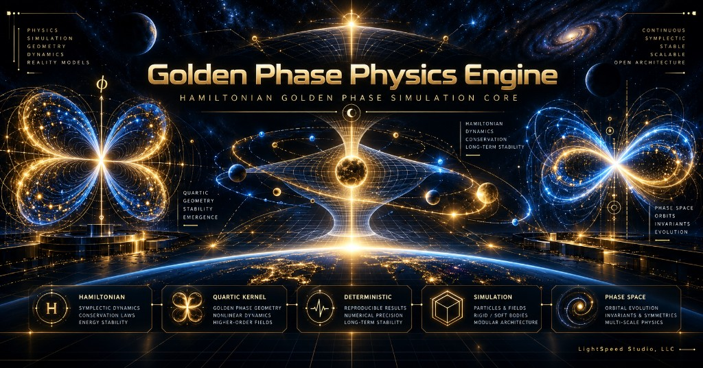

# Golden Phase SDK v0.1



**This repository is the developer SDK and client interface. It is not a standalone executable Golden Phase Physics Engine.**

A client cannot run Golden Phase physics by itself. `goldenphase.dll` speaks the C ABI to a runtime that is provided separately and is not in this repository. The kernel source is not here.

**Deterministic discrete physics — no solvers, no integration, no approximation.**

Golden Phase is a physics engine built on a single quartic kernel
`K_G(u) = u⁴ − φu² + α` where every state change passes through the
kernel setter. The SDK lets developers call that setter through the
C ABI without receiving the kernel implementation.

## Quick Start

```python
from goldenphase import Engine

engine = Engine()
body = engine.create_body()
engine.tick(10)
state = engine.state(body)
print(state.x, state.p, state.energy)
```

## What's Included

| # | Component | Description |
|---|-----------|-------------|
| 1 | `golden_phase.h` | C ABI header |
| 2 | `crates/goldenphase` | Source of the thin C ABI client. Build produces `goldenphase.dll` |
| 3 | `crates/gphase_protocol` | Wire types. No kernel dependency |
| 4 | Python SDK | `pip install goldenphase` |
| 5 | C# SDK | .NET 8 package |
| 6 | Godot addon | Knob ids match the header. The GDScript methods do not call the DLL |
| 7 | 5 Examples | hello_phase, two_body, hamiltonian, gravity, electromagnetic |
| 8 | API Documentation | Full reference + architecture |
| 9 | Community License | Free for individuals and noncommercial use |

Not in this repository: `gphase_runtime.exe`, `gphase-verify`, and the kernel source.

## Architecture

```
Application  →  goldenphase.dll  →  runtime (not in this repository)  →  kernel setter
              (thin C ABI client)
```

Applications never call the kernel directly. The DLL connects to the
separately provided runtime via local IPC and exposes a stable C ABI.
Python and C# call that DLL. The Godot GDScript file does not.

## Supported Operations (v0.1)

- Engine + body lifecycle
- Phase commands on X/P/L knobs
- Central impulse and torque impulse
- Tick: one setter commit and, when that commit publishes, one clock advance
- State observation (decoded roots, not internal packing)
- `gp_read_hamiltonian` returns `h_free` and `g8_inverse`. That readout is not the History lane. History is `GP_KNOB_H` and `GP_State.history`
- Temporal API (clock, seconds, crossing)
- Spatial API (position roots)
- EM charge force mapping (Coulomb interpretation)
- Kernel view (phi, alpha, roots)
- MissingLaw / Refused reporting with feature names
- Version / ABI / schema queries

## What Is Deliberately Absent

- `set_raw_position()` / `set_raw_momentum()` / `write_state_memory()`
- `set_mass()` / `apply_newton_force()`
- Any Newtonian formula or host-side ODE integration
- Direct access to `StateBits256`

Velocity is `dH/d(canonical momentum)`, never `P/m`.

## License

Community License — free for individuals, inventors, students,
and noncommercial experimentation. See `docs/LICENSING.md` for
Academic, Commercial, and Enterprise tiers.

Copyright (c) 2026 LightSpeed Studio LLC. All Rights Reserved.
